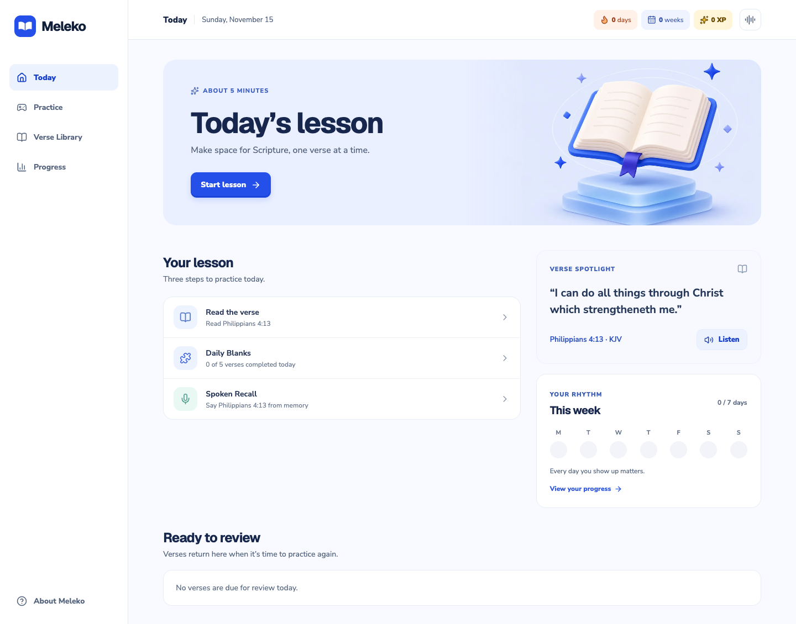
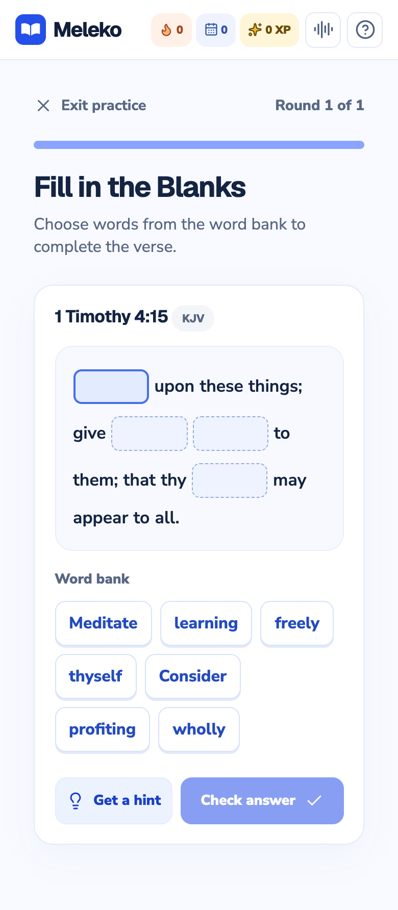

# Meleko

Learn Scripture through play. Remember it for life.

Meleko is an installable Bible memorization game by **San'Quan Prioleau**. Read or listen to five KJV verses, then practice with Fill in the Blanks, Word Ordering, First-Letter Recall, and Spoken Recall. The name takes inspiration from the Greek *meletaō*, meaning to practice or meditate.

[Play Meleko](https://meleko.sprioleau.dev)

## Screenshots

| Today’s lesson | Fill in the Blanks on mobile |
| --- | --- |
|  |  |

[See the practice completion screen](docs/screenshots/practice-complete.png)

## Run locally

Requires Node.js 24 or later.

```sh
npm ci
npm run dev
```

Open [localhost:3000](http://localhost:3000). To enable backend persistence, run `CONVEX_AGENT_MODE=anonymous npm run convex:dev` in a separate terminal before starting Next.js. The Convex CLI writes the local deployment URL to `.env.local`. Practice is saved on the current browser and synced to Convex when configured. The first slice uses a browser-specific player key.

```sh
npm test
npm run typecheck
npm run build
```

## Audio and installation

The five ElevenLabs recordings ship with the app. To regenerate audio, set `ELEVENLABS_API_KEY` in `.env.local`, optionally set `ELEVENLABS_VOICE_ID`, and run `npm run narration:generate`. The command generates missing tracks. Verse playback can fall back to browser speech synthesis.

Spoken Recall uses the browser’s speech recognition when available and also supports typed recall. The score compares the confirmed answer to the verse wording. Recognition availability varies by browser.

On iOS, use Safari’s Share menu and choose **Add to Home Screen**. In supporting Android and desktop browsers, use the browser’s install control. The service worker is enabled in production builds.

## Stack

Next.js App Router, React, TypeScript, Convex, Geist, Nunito Sans, and Vitest. Verse text uses the King James Version.

## Deployment

Production deployments run on Vercel from `main`. The Vercel production environment supplies the Meleko Convex production deploy key as `CONVEX_DEPLOY_KEY` and the site origin as `NEXT_PUBLIC_APP_URL`. The build deploys the Convex schema and functions alongside the Next.js app.
